# ITBDA4-14 Project 2 - Project Documentation

**Student:** Tishey Pillay (EDUV12760295)
**Repository:** https://github.com/TisheyPillay21/itbda4-14-project-2

A full written report with all code listings is provided separately as `ITBDA4-14_Project2_Report.pdf`. This file summarises each question and points to the code, data and evidence in this repository.

## Question 1 - Hadoop MapReduce keyword search
- **Design:** the Driver reads the keyword from the command line and stores it in the job Configuration (nothing is hardcoded). A custom input format makes each document one input split so the Mapper can count rows. The Mapper lowercases each line and the keyword (case-insensitive), finds every occurrence and emits `fileName -> row:col` (1-based). The Reducer sorts the locations per file and writes the file name, the count and every (row, col). The flow diagram is in `q1-mapreduce/README.md` and in the PDF report.
- **Code:** `q1-mapreduce/src/main/java/za/ac/keyword/` (Mapper, Reducer, Driver, `WholeFileTextInputFormat`) and `q1-mapreduce/pom.xml`.
- **How it was run:** built with Maven and run with Hadoop 3.3.6 in local mode on a Linux virtual machine (Google Colab), keyword `africa`.
- **Result:** 22 matches in 4 of the 7 documents (doc1: 3, doc2: 5, doc3: 9, doc5: 5). The job counters agree (22 map output records, 22 reduce input records, 4 reduce groups).

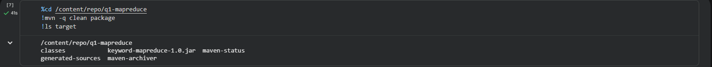
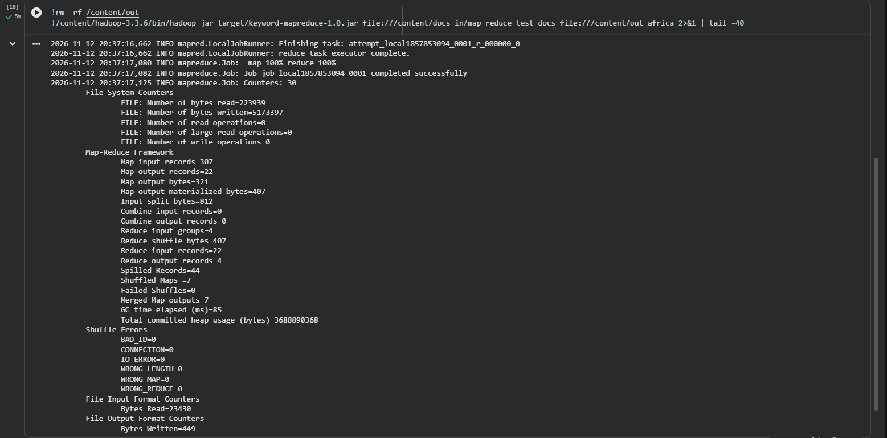
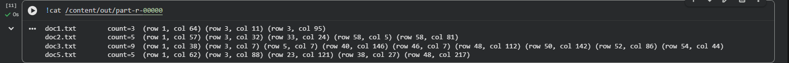

## Question 2 - LDA topic modelling
- **Notebook:** `notebooks/Q2_LDA_topic_modelling.Rmd` (knitted report: `Q2_LDA_topic_modelling.html`).
- **Preprocessing:** the 10 news files were loaded into a data frame (`file_name`, `content`), then cleaned (HTML, URLs, punctuation, digits, stop words, short and rare tokens removed; lemmatisation). Result: 10 documents, vocabulary of 186 terms.
- **Model:** LDA with Gibbs sampling, n = 5 topics, k = 10 words per topic, with word distributions (beta) and document-topic distributions (gamma).
- **Topics found:** government and coalition politics; public service management and reform; police and cold weather (mixed topic); labour, unemployment and education; government payments and Eskom invoices.
- **Limitation:** only ten articles, so topics are broadly interpretable but not very stable. Day and month words are noise that could be added to the stop-word list.

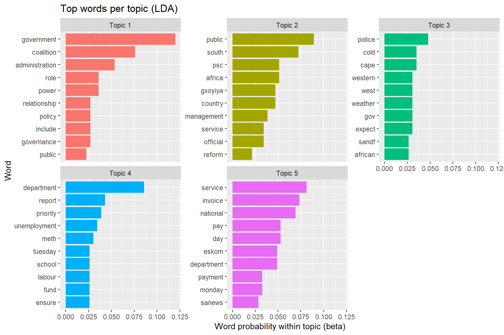
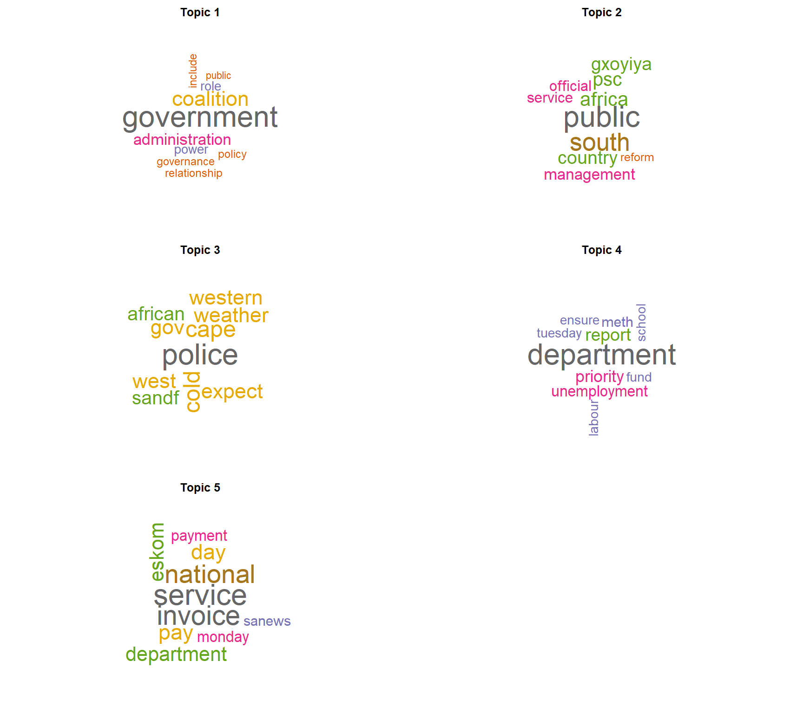
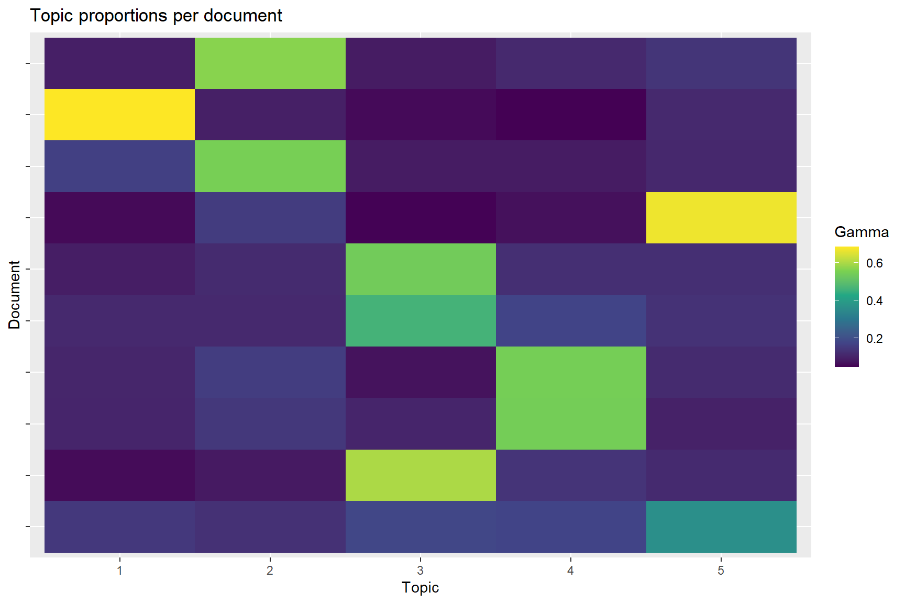

## Question 3 - WebText API proof of concept
- **Notebook:** `notebooks/Q3_WebText_API_summarisation.Rmd` (knitted report: `Q3_WebText_API_summarisation.html`).
- **Website and fair use:** Eurac Research blog article "Can language become environmental data?" (CC BY 4.0). robots.txt was checked, a descriptive User-Agent was sent, requests were rate-limited, and only public article text was collected for educational use with the source credited.
- **Preprocessing:** removal of boilerplate (including an author byline), duplicates, HTML, URLs, stop words and short tokens, plus lemmatisation. Result: 9 of 24 paragraphs kept, 334 tokens, 209 unique terms.
- **Summarisation:** word-frequency (Luhn-style) scoring and TextRank. The two five-sentence summaries share 3 sentences.
- **Findings:** dominant words are impact, drought, language and environmental, so the article is about using language technologies to extract drought-impact information from text. The corpus is a single short article, which limits the analysis.

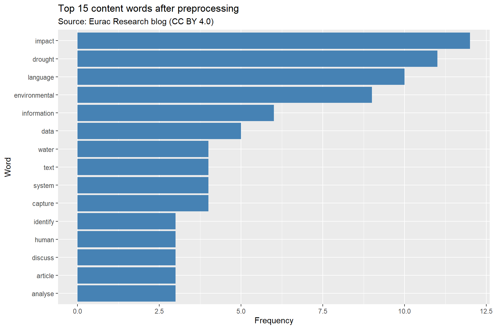
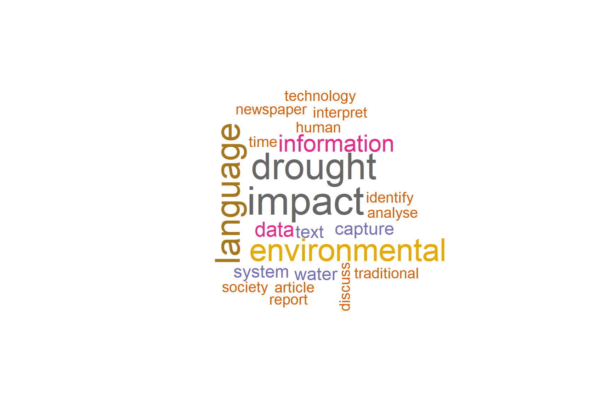
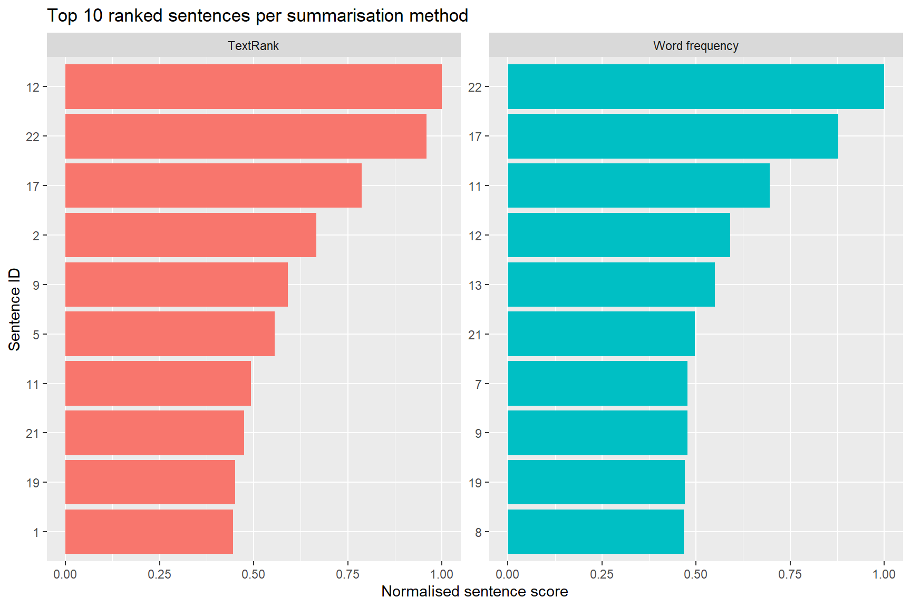
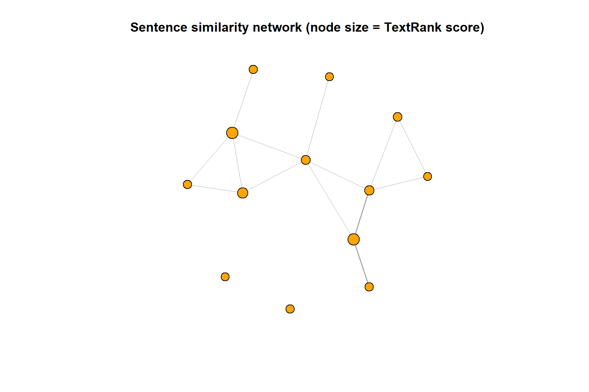

## Question 4 - ETL with R and PostgreSQL
- **Use case:** how price, rating and stock vary across categories in an online bookstore, and which titles are the best value. Source: books.toscrape.com (a public scraping sandbox).
- **Extract:** 40 records scraped with `rvest` (listing and detail pages) with regex-ready raw fields (rating as a CSS class, price as text, padded availability text). Data: `data/raw_books.csv`.
- **Transform:** regex extraction of price, rating, stock and mentioned year; text denoising; duplicate removal; median imputation with flags. Data: `data/clean_books.csv` (40 rows). Only `mentioned_year` has empty values (30), because many descriptions do not mention a year.
- **Load and analyse:** `sql/q4_postgres.sql` creates the table, loads the CSV with `\copy` and runs two investigations (category summary, and the cheapest well-rated books per category using a window function). Setup notes are in `docs/postgres_setup.md`.
- **Results:** 40 rows loaded; 21 categories, most with only one or two books, so category averages rest on small samples; "Default" is the largest group (7 books, average price 25.92); 16 books rated 4 or 5 stars were returned, with *Sophie's World* (15.94, 5 stars) the best value; price does not rise with rating (five-star average 31.65, one-star 34.39).

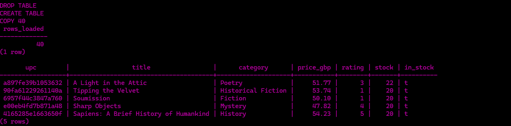
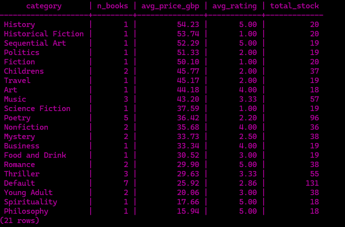
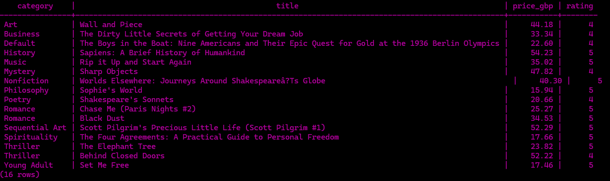

## Repository contents
| Folder | Content |
|---|---|
| `q1-mapreduce/` | Java Hadoop MapReduce project (Q1) |
| `notebooks/` | R Markdown notebooks and knitted reports for Q2, Q3 and Q4 |
| `data/` | Raw and cleaned datasets (Q4); the news data for Q2 is `notebooks/news.zip` |
| `sql/` | PostgreSQL schema, import and analytical queries |
| `docs/` | This documentation, setup notes and evidence images |
