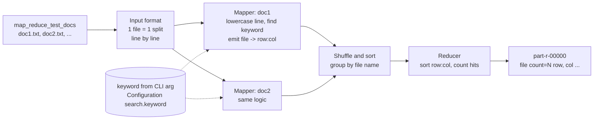

# Q1 - Keyword Location Search with Hadoop MapReduce

## 1.1 Logical layout

Steps
1. The Driver reads the keyword from the command line and stores it in the job Configuration (nothing hardcoded).
2. Each document is one input split, so each Mapper counts rows (1-based) inside its file.
3. Map: lowercase line and keyword (case-insensitive), find every occurrence, emit `(fileName, "row:col")`.
4. Shuffle/sort groups all locations of the same file at one reducer.
5. Reduce: sort the locations by row then column, write `fileName  count=N  (row r, col c) ...`.

## Build
    mvn clean package

## Run (pseudo-distributed or local)
    hdfs dfs -mkdir -p /user/$USER/docs
    unzip map_reduce_test_docs.zip -d docs
    hdfs dfs -put docs/* /user/$USER/docs/
    hadoop jar target/keyword-mapreduce-1.0.jar /user/$USER/docs /user/$USER/out africa
    hdfs dfs -cat /user/$USER/out/part-r-00000

Optional 4th argument `wholeword` matches only the whole word (so "africans" is skipped).

Local mode without HDFS:
    hadoop jar target/keyword-mapreduce-1.0.jar file:///path/to/docs file:///path/to/out africa

## How it was actually run
The jar was built with Maven (Java 11) and executed with Hadoop 3.3.6 in local mode on a Linux virtual machine (Google Colab):

    hadoop jar target/keyword-mapreduce-1.0.jar file:///content/docs_in/map_reduce_test_docs file:///content/out africa
    cat /content/out/part-r-00000

Result for "africa": 22 matches in 4 of the 7 documents (doc1: 3, doc2: 5, doc3: 9, doc5: 5). Screenshots are in `docs/images/`.
